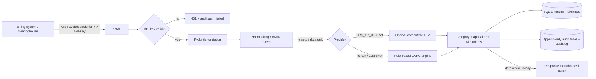

# claim-denial-triage

A small, working demo of an **automated insurance claim-denial triage service** for US healthcare
revenue cycle management (RCM). A billing system or clearinghouse POSTs a denial (835-style CARC/RARC
codes) to a webhook; the service masks the PHI, classifies the denial, drafts an appeal letter with
an LLM (or a deterministic rule engine), stores the result and writes an audit trail.

> All data in this repo is **synthetic**. No real PHI is used.

## Architecture



| File | Purpose |
|---|---|
| `app/main.py` | Endpoints, API-key auth, JSON logging, metrics |
| `app/masking.py` | PHI tokenisation (HMAC), regex scrubbing, detokenise |
| `app/classifier.py` | Provider pattern: `RuleBasedProvider` and `OpenAICompatibleProvider` |
| `app/storage.py` | SQLite results + append-only audit (triggers block UPDATE/DELETE) |
| `app/config.py` | All settings from env vars |

Endpoints: `GET /health` (public), `POST /webhook/denial`, `GET /results/{id}`, `GET /metrics` (all need `X-API-Key`).

## HIPAA-minded design choices
- **Minimum necessary:** the LLM gets only the fields it needs, with PHI swapped for tokens. The DB keeps
  only the *tokenised* letter. The real letter goes back only to the authenticated caller.
- **Masking / tokenisation:** name, DOB and member ID become `[PATIENT_ab12cd34]`-style HMAC tokens
  (same value gives the same token, and you can't reverse one without `TOKEN_SECRET`). Free text is also regex-scrubbed for dates/SSNs.
- **Access control:** every endpoint except `/health` needs an API key. Keys map to a client id, so we know *who*
  acted and the key itself is never logged or stored.
- **Auditability:** each receive/triage/view/auth-failure is logged with who, when, action and record id, and no PHI.
  SQLite triggers make the audit table append-only, and the file log is opened in append mode.
- **Secure AI use:** the provider is pluggable through env vars (`LLM_BASE_URL` can point at a BAA-covered or
  self-hosted endpoint), temperature is 0, and any LLM failure falls back to the deterministic rules so the pipeline never
  breaks. A test proves the LLM prompt never contains raw PHI.
- **Ops:** JSON logs (ready for SIEM), a non-root Docker user, and secrets only from the environment.
  *For production you'd add:* TLS, a secrets manager, encryption at rest, key rotation, and a human review before any appeal is sent.

## Run it
```bash
python -m venv .venv && . .venv/bin/activate
pip install -r requirements.txt
pytest -v                                   # 13 tests
uvicorn app.main:app --port 8000            # rules mode (no API key needed)
python scripts/send_sample.py               # in another terminal
# Optional LLM mode:
export LLM_API_KEY=sk-... LLM_BASE_URL=https://api.openai.com/v1 LLM_MODEL=gpt-4o-mini
# Docker:
docker build -t denial-triage . && docker run -p 8000:8000 -e TRIAGE_API_KEYS=dev-key-123:demo-client denial-triage
```
Env vars: `TRIAGE_API_KEYS` (`key:client,...`), `TOKEN_SECRET`, `TRIAGE_DB_PATH`, `TRIAGE_AUDIT_LOG`, `LLM_*`.

See `docs/demo-output.txt` and `docs/test-output.txt` for a recorded run.
